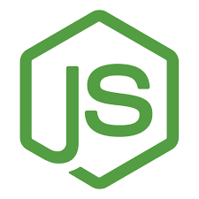
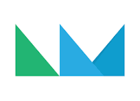

# 👋 Hi, I'm Juan Pablo Galli
### 🚀 Full Stack Developer & Software Engineering Student | Ex-CPA

An analytical and business-minded **Full Stack Developer** transitioning from a background as a **Certified Public Accountant (CPA - UBA)** into engineering high-performance software solutions. Armed with over **800+ hours of intensive full-stack development** at SoyHenry Bootcamp and prior corporate experience at top firms like **PwC** and Banks, I bridge the gap between complex business logic and robust, scalable code.

🎯 **What I bring to the table:**
* **Full-Stack Proficiency:** Deep practical experience engineering web applications using **JavaScript**, **React**, **Redux**, **Node.js**, **Express**, **PostgreSQL**, and **TypeScript**.
* **Fintech & Business Mindset:** Naturally equipped to handle financial integrations, payment gateways (like **Mercado Pago**), data auditing, and complex multi-criteria business rules due to my extensive financial background.
* **Agile Mindset:** Experienced working under **Scrum methodologies**, actively participating in daily standups, sprint planning, and retrospectives to ensure fast, iterative product delivery.
* **Continuous Evolution:** Currently mastering **MongoDB**, **Docker**, and cloud deployment automation with **Vercel** and **Railway**.

---

## 🛠️ Tech Stack

 

### Frontend  

  
  &nbsp;&nbsp;
  
  &nbsp;&nbsp;
  
  &nbsp;&nbsp;
  
  &nbsp;&nbsp;
  
  &nbsp;&nbsp;
  
  &nbsp;&nbsp;
  
  &nbsp;&nbsp;
  
  &nbsp;&nbsp;

 

### Backend & Database  

  
  &nbsp;&nbsp;
  
  &nbsp;&nbsp;
  
  &nbsp;&nbsp;
  
  &nbsp;&nbsp;
  
  &nbsp;&nbsp;
  
  &nbsp;&nbsp;
  
  &nbsp;&nbsp;
  
  &nbsp;&nbsp;

 

### Dev Tools & Deployment  

  
  &nbsp;&nbsp;
  
  &nbsp;&nbsp;
  
  &nbsp;&nbsp;
  
  &nbsp;&nbsp;
  
  &nbsp;&nbsp;
  
  &nbsp;&nbsp;
  
  &nbsp;&nbsp;
  
  &nbsp;&nbsp;

---

## 💻 Featured Projects

| Project | Technical Overview & Core Architecture | Deployment & Demos |
| :--- | :--- | :--- |
| **✨ María Marta Galli** | **Production Freelance Project.** A full-scale digital platform built for a real-world Astrology & Holistic Therapy practice. Implemented a secure administrative Dashboard featuring dynamic real-time CRUD workflows for client records management, services cataloging, and automated online session tracking. | [🌐 Live Site](https://mariamartagalli.com.ar) |
| **🛍️ ShopFlow E-commerce** | **Full-Stack Commercial Platform.** End-to-end e-commerce infrastructure refactored from a legacy codebase to maximize retail performance. Formulated robust relational databases, secure product CRUD mechanics, advanced multi-criteria filtering algorithms, and automated transactional emails via Nodemailer. Integrated **Mercado Pago** checkout gateways, Firebase Auth, and Cloudinary. | [🌐 Live Demo](https://shopflow-ecommerce-demo.vercel.app/) |
| **🏎️ Drivers SPA** | **Single Page Application (SPA).** Individual architectural development focused on modular component structures to manage multi-criteria dynamic filtering, client-side pagination, and complex relational data mapping without external libraries. Resolved complex back-end many-to-many integrations (M:N) with PostgreSQL utilizing Sequelize. | [🌐 Live Site](https://f1-drivers-spa.vercel.app/)   [📺 Video Walkthrough](https://youtu.be/5EJk7emG87s) |

---

## 📄 About Me

* 🎓 **B.S. in Software Engineering** | Estácio University (Brazil) — *In Progress*
* 📜 **Full Stack Web Development Diploma** | SoyHenry Bootcamp (*800+ intensive hours*)
* 📊 **Certified Public Accountant (CPA)** | Universidad de Buenos Aires (Argentina)
* 🗣️ **Languages:** Spanish (Native) | Portuguese (B2) | English (B2).

---

## 📫 Connect With Me

A open-network professional looking forward to collaborating on business-driven development teams. Let's build something efficient together!

  
  &nbsp;&nbsp;&nbsp;&nbsp;
  
  &nbsp;&nbsp;&nbsp;&nbsp;
  
  &nbsp;&nbsp;&nbsp;&nbsp;
  

